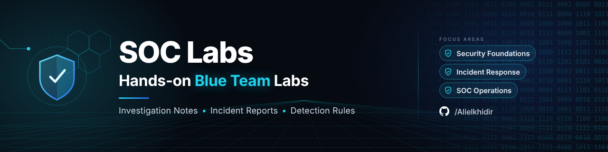

  

  
  
  

## About This Repository

Hands-on cybersecurity labs, investigation notes, incident reports, and detection rule templates, written while I build my skills in Security Operations, threat detection, and incident response.

Each lab has its own folder and README. Everything here uses lab environments or public information only, never real or sensitive data. I add new labs as I finish them, so this index keeps growing.

## Lab Index

### Foundations

| # | Lab | What it covers |
|---|---|---|
| 1 | [Windows & Linux Admin Labs](https://github.com/Alielkhidir/SOC-Labs/tree/main/cybersecurity-windows-linux-admin-labs) | User management, Defender, firewall, apt updates |
| 2 | [Network Design & Firewall Security](https://github.com/Alielkhidir/SOC-Labs/tree/main/network-design-and-firewall-security-lab) | Subnetting, Wireshark, firewall rules |
| 3 | [Pentest Planning & Encryption](https://github.com/Alielkhidir/SOC-Labs/tree/main/pentest-planning-and-encryption-lab) | CVE research, Google dorking, AES-256 |

### Incident Response

| # | Lab | What it covers |
|---|---|---|
| 4 | [Incident Response & Forensics Plan](https://github.com/Alielkhidir/SOC-Labs/tree/main/incident-response-and-forensics-plan) | NIST IR lifecycle, evidence handling |
| 5 | [Equifax Breach Case Study](https://github.com/Alielkhidir/SOC-Labs/tree/main/equifax-data-breach-case-study) | Root cause analysis, lessons learned |

### SOC Operations (planned)

| Lab | Planned focus | Status |
|---|---|---|
| Splunk | Searching and alerting on log data | Planned |
| Microsoft Sentinel | Cloud SIEM queries and incidents | Planned |
| Sysmon | Endpoint telemetry and event analysis | Planned |
| Threat Hunting | Hypothesis-driven hunts through logs | Planned |
| Phishing Analysis | Investigating suspicious emails | Planned |

## How Each Lab Is Written

New labs follow a single [lab template](Templates/lab-template.md): objective, environment, steps, findings, evidence, MITRE ATT&CK mapping, and lessons learned. That keeps every write-up easy to read and easy to compare.
