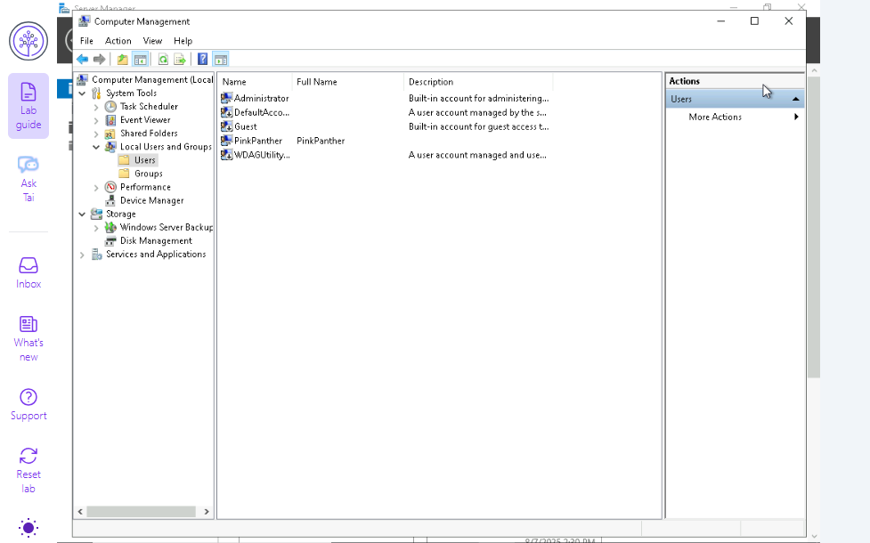
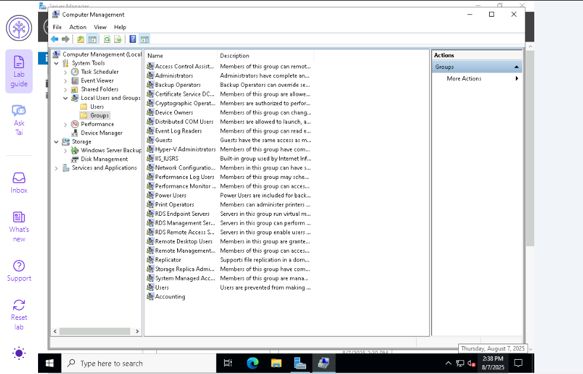
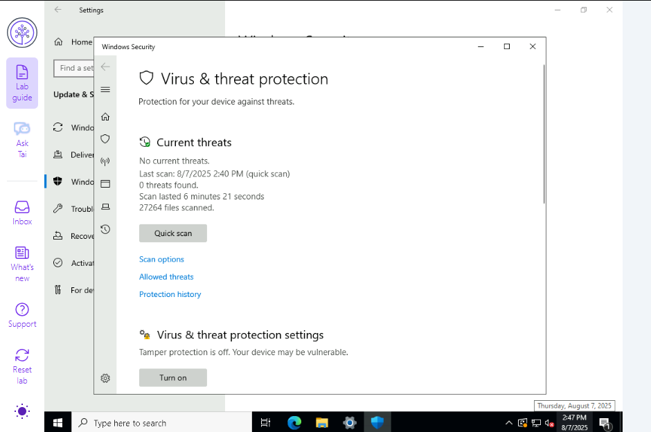
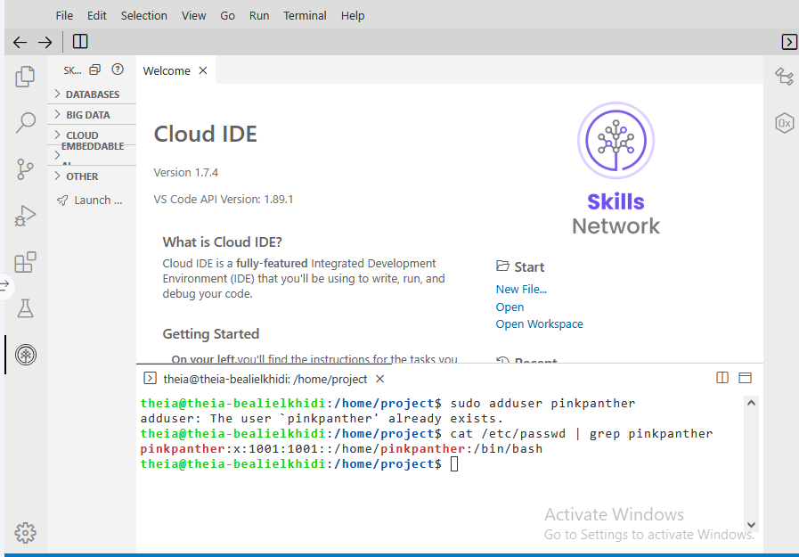
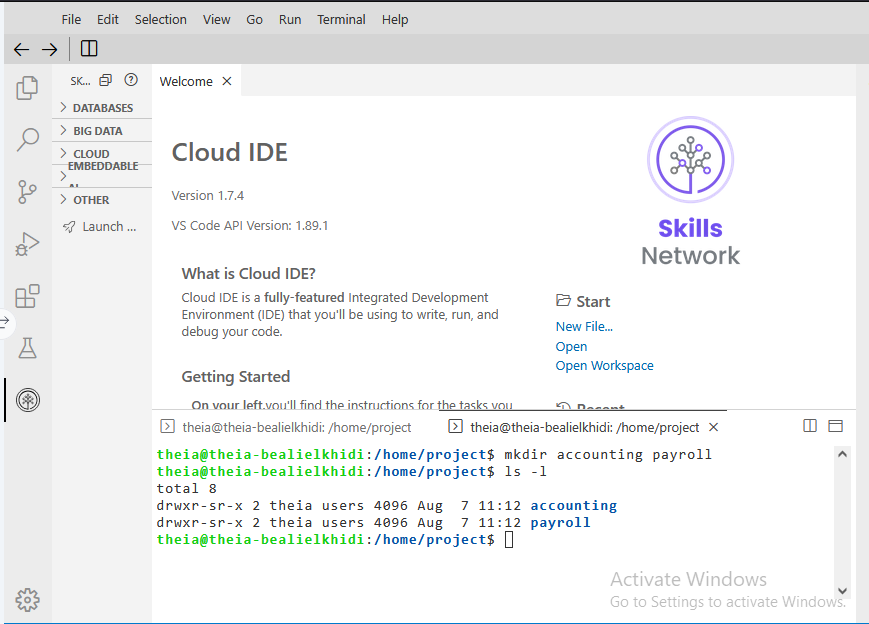
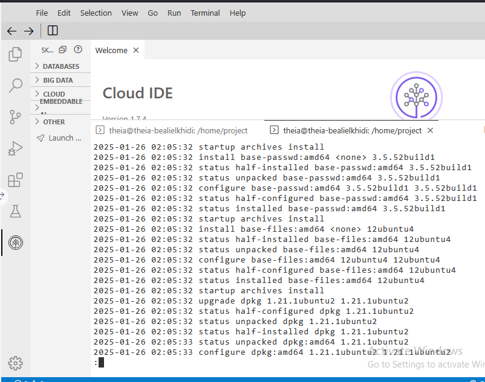

[← Back to SOC Labs](https://github.com/Alielkhidir/SOC-Labs)

# Windows & Linux Admin Labs

Six support tickets across Windows Server and Linux, worked as a junior analyst at a fictional company, "Cyber Secure Inc.". The lab is part of the IBM Cybersecurity Analyst program, and this page describes my own work and results.

| | |
|---|---|
| **Level** | Beginner |
| **Date** | Aug 2025 |
| **Source** | IBM Cybersecurity Analyst Professional Certificate |
| **Environment** | Windows Server and an Ubuntu terminal (Skills Network Cloud IDE) |
| **Tools** | Computer Management, Windows Security, Windows Defender Firewall with Advanced Security, `adduser`, `mkdir`, `touch`, `ls`, `apt`, `less` |

## Results at a Glance

| # | Ticket | Platform | Outcome | How I verified it |
|---|---|---|---|---|
| 1 | Create a user and a group | Windows | `PinkPanther` account and `Accounting` group created | Both listed in Local Users and Groups |
| 2 | Virus & threat protection | Windows | Checked for updates and ran a Quick Scan: 0 threats, 27,264 files scanned | Scan result screen |
| 3 | Firewall rule | Windows | Inbound rule "Port 80 Permitted" (TCP 80) created | Rule shown as enabled in Inbound Rules |
| 4 | Create a user | Linux | `pinkpanther` account confirmed | `/etc/passwd` entry (UID 1001) |
| 5 | Files and folders | Linux | `accounting` and `payroll` folders and a `best practices` file created | `ls -l` output |
| 6 | System updates | Linux | Ran `apt update` and `apt upgrade` | Package activity in `/var/log/dpkg.log` |

## Skills Demonstrated

- User and group management on Windows Server and Linux
- Endpoint protection: Windows Defender updates and scans
- Host firewall configuration (inbound rules)
- Linux command line and log review
- System patching and update verification

---

## Part 1: Windows

### Ticket 1: Create a user and a group

Created a local user account (`PinkPanther`) with a strong password in Computer Management, then created a group named `Accounting`.

**Why it matters:** Access control starts with clean identity management. Separate accounts and groups let permissions be granted per role instead of per person.

*The new `PinkPanther` account under Local Users and Groups > Users.*

*The new `Accounting` group under Local Users and Groups > Groups.*

### Ticket 2: Virus & threat protection

Checked for updates in Windows Update and Windows Security, then ran a Quick Scan to confirm the system was protected.

**Why it matters:** Up-to-date protection and a clean scan give a baseline for what a healthy endpoint looks like.

*Windows Update showing pending updates (including the Malicious Software Removal Tool) and the time of the last check.*

*Quick Scan completed on 8/7/2025: 0 threats found, 27,264 files scanned.*

### Ticket 3: Firewall rule

In Windows Defender Firewall with Advanced Security, I created an inbound rule named **Port 80 Permitted** that allows TCP port 80 on the Domain, Private, and Public profiles.

**Why it matters:** Every inbound rule widens what can reach the host. The ticket asked for port 80 on all profiles, but in a real environment I would limit the rule to the profiles and source addresses that need it, and prefer HTTPS (port 443).

*"Port 80 Permitted" at the top of the Inbound Rules list: enabled, profile All, action Allow.*

---

## Part 2: Linux

### Ticket 4: Create a user

Used `sudo adduser` to create a user, then verified it with `cat /etc/passwd | grep pinkpanther`.

**Why it matters:** Linux accounts live in `/etc/passwd`. Checking the entry confirms the account exists and shows its UID, home directory, and shell.

*The account already existed from earlier in the session, hence the "already exists" message. The `/etc/passwd` entry confirms UID 1001, its home directory, and its `/bin/bash` shell.*

### Ticket 5: Files and folders

Created the `accounting` and `payroll` directories with `mkdir`, then created a `best practices` file inside `accounting` with `touch`.

**Why it matters:** Separate folders are the first step toward separating duties. In a real setup I would also set ownership and permissions (`chown`, `chmod`) so only the right group can read each folder.

*`mkdir accounting payroll` followed by `ls -l` confirming both folders.*

*`ls -l accounting` showing the new `best practices` file.*

### Ticket 6: System updates

Ran `sudo apt update` and `sudo apt upgrade`, then reviewed recent package activity with `less /var/log/dpkg.log`.

**Why it matters:** Patching closes known vulnerabilities, and the log shows exactly what changed.

*The dpkg log showing packages being installed, unpacked, and configured (e.g. `base-passwd`, `base-files`, `dpkg`).*

---

## The SOC Perspective

I did not collect these logs in this lab. This table is what an analyst would look for when monitoring the same kinds of activity, and it is what I plan to practice next.

| Activity in this lab | Where it shows up |
|---|---|
| New local user (Windows) | Security log, Event ID 4720 |
| New local group (Windows) | Security log, Event ID 4731 |
| Firewall rule added (Windows) | Security log, Event ID 4946 (needs the audit policy enabled) |
| Malware detected by Defender | Defender Operational log, Event ID 1116 |
| New user (Linux) | `/var/log/auth.log` entry from `useradd` |
| Package changes (Linux) | `/var/log/dpkg.log` and `/var/log/apt/history.log` |

## What I Learned

- Managing local identities and groups on both Windows and Linux
- Why up-to-date endpoint protection matters, and why firewall rules should be as narrow as the job allows
- How to verify a change (with `/etc/passwd`, `ls -l`, and update logs) instead of assuming it worked

## Next Steps

- Repeat the Windows tasks and find the matching events in Event Viewer
- Practice file ownership and permissions with `chown` and `chmod`
- Search the same activity in Splunk, as part of the planned SOC Operations labs

*Lab provided by IBM. This page describes my own work and results.*
