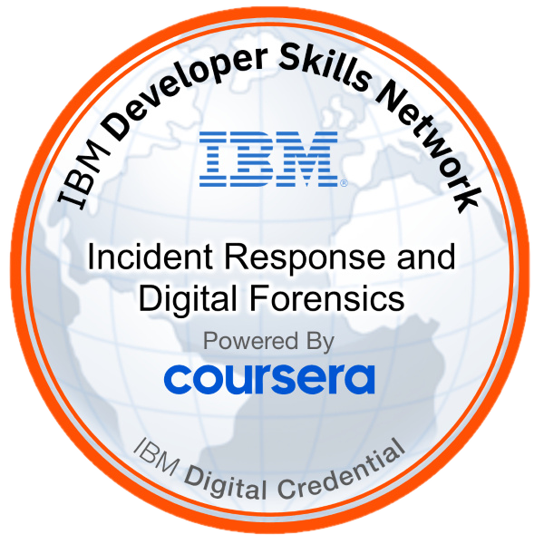
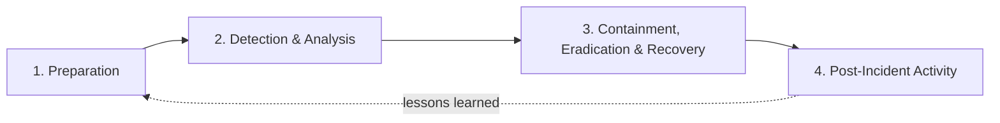

# Incident Response & Digital Forensics Plan

Final project from the IBM incident response and forensics course (Coursera). I acted as a security analyst drafting a formal incident response (IR) plan, based on the NIST framework, for a fictional company, "SecureSync Corp.", and then defined a standard process for digital forensics investigations. This page is my own work and wording.

| | |
|---|---|
| **Level** | Beginner |
| **Date** | Nov 2025 |
| **Type** | Planning and documentation project |
| **Source** | IBM Cybersecurity Analyst Professional Certificate (Coursera) |
| **Frameworks** | NIST incident response lifecycle |

## IBM Badge Earned

<table>
  <tr>
    <td width="150" align="center">
      
    </td>
    <td>
      <b>Incident Response and Digital Forensics</b> 
      Issued by IBM through Coursera on 16 Nov 2025. This project was part of the coursework for earning this badge.  
      <a href="https://www.credly.com/badges/c74bc0bb-23b8-40dd-ab0a-708849eb3fc1">Verify on Credly →</a>
    </td>
  </tr>
</table>

## What I Produced

| Deliverable | What it contains |
|---|---|
| Incident response plan | Four NIST phases: preparation, detection and analysis, containment/eradication/recovery, and post-incident activity |
| Digital forensics process | Four phases: collection, examination, analysis, and reporting |
| Sample incident report | A fictional report for the SecureSync scenario, written to the four-component structure |

## Skills Demonstrated

- Incident response planning with the NIST lifecycle (preparation, detection and analysis, containment/eradication/recovery, post-incident activity)
- Defining IR team roles and responsibilities
- Security monitoring and incident documentation
- Digital forensics: evidence collection, integrity verification, analysis, and reporting
- Technical writing for both technical and executive audiences

## Scenario (Summary)

SecureSync Corp. is a mid-sized cloud software company (500+ employees, offices in San Francisco, Austin, and Boston, about 200,000 users) running a hybrid on-premises and cloud (Azure and AWS) environment. It has firewalls, IDPS, endpoint protection, AES encryption, role-based access control, and centralized logging, but **no formal incident response plan**.

In the exercise, the IDS flagged unusual activity on the email server. Logs showed remote logins at odd hours from unusual locations, and packet captures suggested data exfiltration. The root cause was a spear-phishing email that compromised mailboxes and gave attackers a backdoor. The plan below is what the company needs to handle an incident like this consistently.

**Key threats:** spear-phishing, malware-based data exfiltration, unauthorized remote access.
**Key weaknesses:** no documented IR plan, users vulnerable to phishing, a high-value email server holding sensitive client data.

---

## Part 1: Incident Response Plan (NIST Framework)

### Phase 1: Preparation

Four key roles for the IR team:

| Role | Responsibilities |
|---|---|
| Incident Response Team Leader | Oversees and coordinates all response activities, assigns tasks, makes decisions, and keeps all teams communicating. |
| Technical Specialist | Performs malware analysis and system forensics, carries out containment actions, and identifies affected systems. |
| Communication Liaison | Manages internal and external communication, updates leadership, and informs clients when needed. |
| Security Analyst | Monitors alerts, reviews logs, investigates suspicious activity, and helps identify attack vectors and indicators of compromise. |

### Phase 2: Detection and Analysis

**Monitoring checklist for unusual activity**

- [ ] Review IDS/IDPS alerts for anomalous network behavior
- [ ] Analyze system and application logs for irregular login patterns
- [ ] Monitor endpoint protection alerts and threat detections
- [ ] Track network traffic for unusual outbound connections or data exfiltration attempts

**Details to record for every detected incident**

1. Date, time, and method of initial detection
2. Systems, accounts, or data affected
3. Indicators of compromise (suspicious IPs, files, login attempts)
4. Attack vector (for example phishing emails or exploited vulnerabilities)

### Phase 3: Containment, Eradication, and Recovery

| Containment strategy | How it helps |
|---|---|
| Account deactivation | Disabling compromised accounts stops attackers from continuing to access internal systems. |
| Network segmentation / isolation | Isolating affected servers or network segments stops malware from spreading and limits further data exfiltration. |

### Phase 4: Post-Incident Activity

**Four-step post-incident review**

1. Document the full timeline of events and response actions
2. Analyze what worked well and where delays or issues occurred
3. Identify gaps in security tools, communication, or processes
4. Recommend improvements and update policies and training programs

**Checklist for updating the response plan**

- [ ] Update incident response procedures based on lessons learned
- [ ] Revise and improve employee security training and phishing awareness
- [ ] Integrate new threat intelligence and update detection rules or tools

---

## Part 2: Digital Forensics Investigation Process

### Phase 1: Data Collection

Four sources of digital evidence:

1. System and application log files
2. Network traffic captures and packet details
3. Email records, including phishing messages and attachments
4. Malware samples and forensic images from compromised devices

### Phase 2: Examination

Three steps to assess evidence and verify its integrity:

1. Create and verify cryptographic hashes to ensure the evidence has not been altered
2. Analyze the evidence in a controlled forensic environment
3. Document all findings and maintain a clear chain of custody

### Phase 3: Analysis

Evidence to review to determine how the breach started and how it worked:

| Evidence type | Purpose |
|---|---|
| Log files | Identify timestamps, suspicious logins, system events, and the attacker's actions. |
| Network traffic captures | Determine whether data was exfiltrated, which external servers were contacted, and how the attacker moved inside the network. |
| Email and phishing artifacts | Reveal how the attack began, including malicious links, attachments, and social engineering techniques. |

### Phase 4: Reporting

Every incident report should include:

| Component | Description |
|---|---|
| Executive summary | High-level overview of the incident, its impact, and the final outcome, written for leadership. |
| Technical analysis | Details of the attack vector, malware behavior, affected systems, and forensic findings. |
| Response actions | The containment, eradication, and recovery steps the team took. |
| Lessons learned and recommendations | Gaps discovered, improvements needed, and steps to strengthen future incident response. |

---

## Applying the Plan: Sample Incident Report

To show the plan in practice, I wrote a fictional incident report for the SecureSync scenario, following the four-component structure from Part 2.

---

## The SOC Perspective

This table shows how the scenario's events would be checked by an analyst working a similar alert.

| What happened in the scenario | What an analyst would check |
|---|---|
| The IDS flagged unusual email server activity | Validate the alert, then scope which accounts and systems are involved. |
| Remote logins at odd hours from unusual locations | Sign-in logs (for example Windows Event ID 4624 and cloud sign-in logs): time, source location, device, and impossible travel. |
| Packet captures suggested data exfiltration | Firewall, proxy, and flow logs: unusual outbound volume and unfamiliar destinations. |
| Spear-phishing compromised mailboxes | What happened after the login: new inbox rules, forwarding settings, and newly registered MFA devices. |
| Evidence must stand up later | Hashes taken before analysis, working on copies, and a documented chain of custody. |

## What I Would Add in a Real Plan

This lab was a guided exercise, so some parts are kept short. In a real plan I would also define:

- **Eradication and recovery steps:** remove the backdoor and malware, reset credentials, revoke active sessions, restore from clean backups, then monitor closely
- **Severity levels and escalation:** who is called, and when, for each level of incident
- **Legal and notification duties:** when clients and regulators must be informed
- **Order of volatility:** collecting the most short-lived evidence (such as memory) first

## What I Learned

- How the NIST incident response lifecycle turns an ad-hoc reaction into a repeatable process
- Why documentation, chain of custody, and hash verification matter if evidence must stand up later
- How to write for two audiences, with technical detail for responders and a clear summary for executives
- How containment choices (account lockout, segmentation) trade speed against business disruption

*Lab provided by IBM via Coursera. The scenario is fictional. This document is my own work and wording.*
