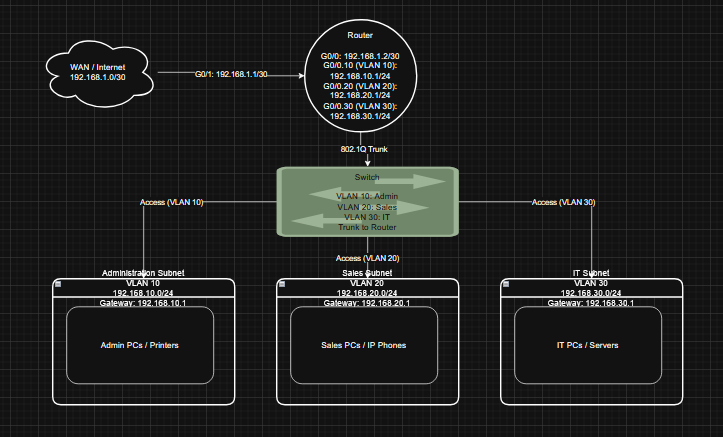
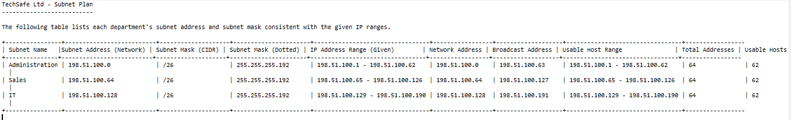
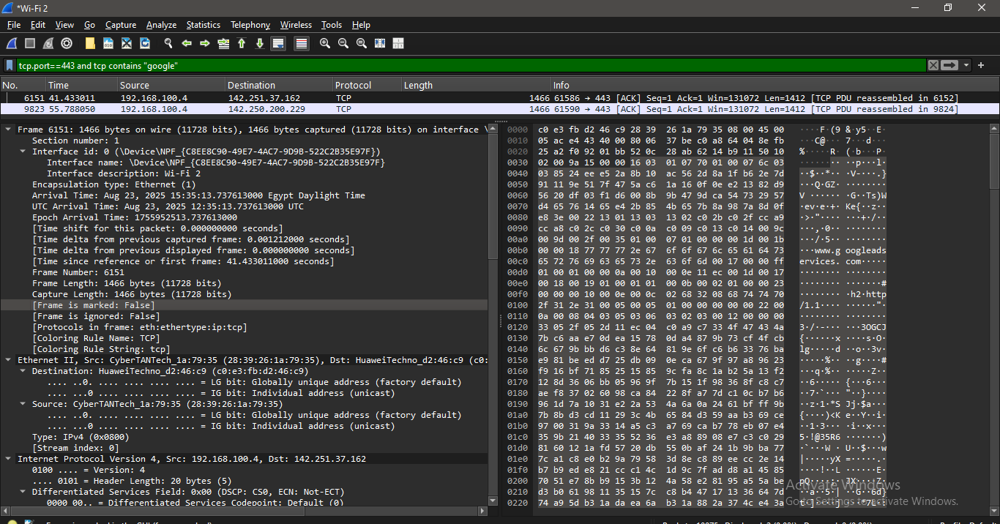
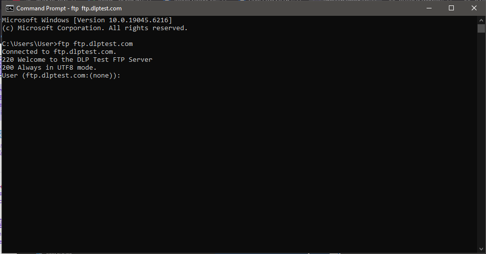
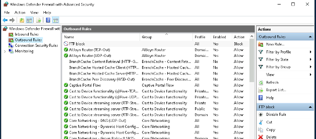
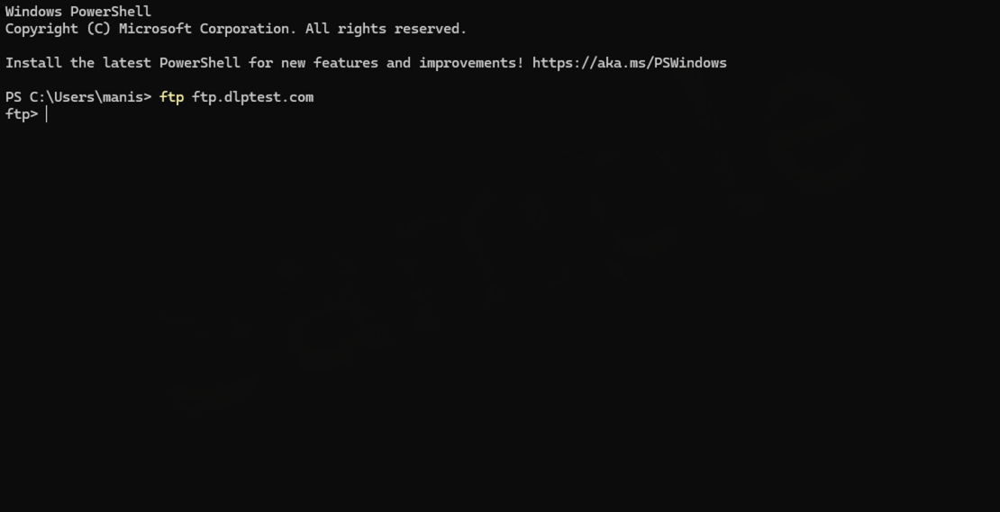
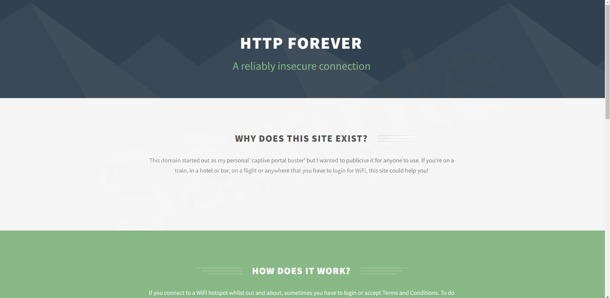
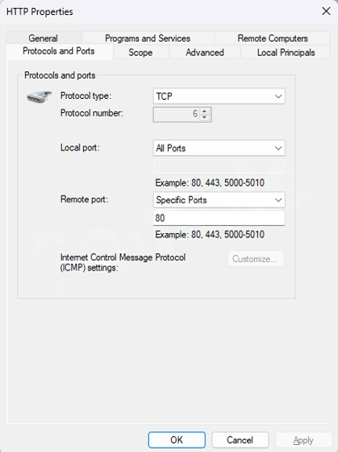
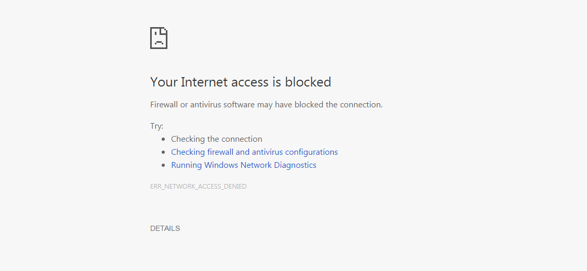

# Network Design & Firewall Security Lab

Final project from an IBM networking and security course (Coursera). I planned a network for a fictional company, "TechSafe, Ltd.", then analyzed web traffic and enforced security policy with host firewall rules.

## Skills demonstrated
- Network design with VLAN-based subnets (router, switch, three departments)
- IPv4 subnetting with CIDR and subnet masks
- Packet capture and display filtering with Wireshark
- Outbound firewall rules in Windows Defender Firewall with Advanced Security
- Testing and verifying security controls

## Tools
Wireshark · Windows 10 · Windows Defender Firewall with Advanced Security · Command Prompt (FTP client) · draw.io-style diagramming

---

## Task 1: Network design with subnets
Designed a network with one router, one switch and three subnets (Administration, Sales, IT). The router connects to the switch over an 802.1Q trunk, and each department sits in its own VLAN so traffic is segmented.
   
*Router and switch connected to the Administration, Sales and IT subnets.*

  
## Task 2: Subnet addresses and masks
Each department was given a /26 block (64 addresses, 62 usable hosts).
   
| Subnet | Network address | Mask | Usable host range | Broadcast |
|---|---|---|---|---|
| Administration | 198.51.100.0/26 | 255.255.255.192 | .1 – .62 | 198.51.100.63 |
| Sales | 198.51.100.64/26 | 255.255.255.192 | .65 – .126 | 198.51.100.127 |
| IT | 198.51.100.128/26 | 255.255.255.192 | .129 – .190 | 198.51.100.191 |
*Subnet plan generated for later reference.*

  

## Task 3: HTTPS traffic analysis with Wireshark
Captured traffic on my Wi-Fi interface and used the display filter `tcp.port==443 and tcp contains "google"` to isolate HTTPS (TLS) packets to Google services, then inspected packet details and bytes. The server name is visible in the TLS handshake even though the payload is encrypted.
   
*Filtered HTTPS packets with frame, Ethernet, IP and TCP details expanded.*

    
## Task 4: Firewall rules in Windows Defender Firewall
  
### 4.1 FTP access before the rule
Confirmed the baseline: I could reach the public test server `ftp.dlptest.com`.
   
*Connection established and FTP login prompt displayed.*

  

### 4.2 Block FTP
Created an outbound rule named **FTP block** that blocks FTP traffic.
   
*The "FTP block" rule in Outbound Rules: enabled, action Block.*

  

### 4.3 Verify FTP is blocked
   
*FTP connection to ftp.dlptest.com fails after the rule is applied.*

  

### 4.4 HTTP site before the rule
   
*http://httpforever.com loads normally.*

  

### 4.5 Block HTTP
   
*Outbound rule blocking TCP port 80.*

  

### 4.6 Verify HTTP is blocked
   
*http://httpforever.com can no longer be reached.*

  

---

## What I learned
- How VLANs and subnets segment departments and how to size /26 blocks
- How to read encrypted traffic metadata in Wireshark with display filters
- How to enforce and verify security policy with firewall rules (test before, apply, test after)

*Lab provided by IBM via Coursera. This README describes my own work and results.*
