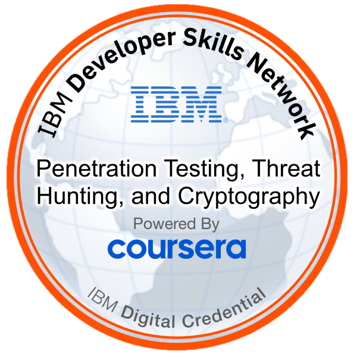

<a href="https://github.com/Alielkhidir/SOC-Labs"></a>

# Penetration Test Planning & Symmetric Encryption Lab

Played an ethical hacker hired by a fictional mid-sized financial institution, "SecureBank", to research a vulnerability, plan a penetration test, and protect sensitive data with encryption. The lab is provided by IBM, and this page describes my own work and results.

| | |
|---|---|
| **Level** | Beginner |
| **Date** | Nov 2025 |
| **Source** | IBM Cybersecurity Analyst Professional Certificate |
| **Environment** | Web browser and a Linux terminal (Skills Network Cloud IDE) |
| **Tools** | IBM X-Force Exchange, Google Search, OpenSSL |

## IBM Badge Earned

<table>
  <tr>
    <td width="150" align="center">
      <a href="https://www.credly.com/badges/e2107b13-caf3-4a9b-b618-9c5677caef84"></a>
    </td>
    <td>
      <b>Penetration Testing, Threat Hunting, and Cryptography</b><br>
      Issued by IBM through Coursera on 15 Nov 2025. This lab was part of the coursework for earning this badge.<br><br>
      <a href="https://www.credly.com/badges/e2107b13-caf3-4a9b-b618-9c5677caef84">Verify on Credly →</a>
    </td>
  </tr>
</table>

## Results at a Glance

| Part | Task | Outcome | How I verified it |
|---|---|---|---|
| 1 | Vulnerability research | Selected CVE-2025-13057 (SQL injection, CVSS 6.3) in IBM X-Force Exchange | X-Force report and CVSS breakdown |
| 1 | OSINT with Google dorking | Three searches to find public sources about the CVE | Search results for each query |
| 1 | Penetration test plan | Six-phase plan for SecureBank with a justification for each decision | Plan table |
| 2 | Encrypt a file | Encrypted sample credentials with AES-256-CBC | Unreadable output with the `Salted__` header |
| 2 | Decrypt a file | Recovered the original file with the same key | Decrypted output matched the original |

## Skills Demonstrated

- Threat intelligence and CVE research (IBM X-Force Exchange)
- OSINT with Google dorking operators (`site:`, `filetype:`)
- Penetration test planning: scope, objectives, rules of engagement, discovery, exploitation, reporting
- Symmetric encryption and decryption with OpenSSL (AES-256-CBC)
- Linux command line: `touch`, `echo`, `cat`, `openssl`

---

## Part 1: Vulnerability Analysis and Penetration Test Planning

### Task 1: Identify a vulnerability with IBM X-Force Exchange

Searched X-Force Exchange for a recent vulnerability with a CVE ID and selected **CVE-2025-13057**, an SQL injection flaw in the Campcodes School Fees Payment Management System 1.0 (CVSS 6.3, network attack vector, low complexity, public exploit available).

**Why it matters:** A CVSS score is only a starting point. Attack vector, complexity, and whether an exploit is public all change how urgently a fix is needed.


*X-Force Exchange report for CVE-2025-13057 showing the description and the CVSS 3.0 breakdown.*

### Task 2: Investigate the CVE with Google Dorking

I ran three searches, each narrower than the last. They are shown as typed in the lab. Google's own syntax has no space after the colon (for example `site:gov` and `filetype:pdf`).

| Step | Query as typed | Correct syntax | Purpose |
|---|---|---|---|
| 1 | `site: CVE-2025-13057` | `CVE-2025-13057` | Find public sources describing the CVE |
| 2 | `site: gov CVE-2025-13057` | `site:gov CVE-2025-13057` | Narrow results toward government sources |
| 3 | `site: gov CVE-2025-13057 filetype: pdf` | `site:gov CVE-2025-13057 filetype:pdf` | Look for PDF reports on government sites |

**Step 1** pulled up public sources describing the vulnerability, including NIST NVD, the CVE.org record, and CVE Details.


*Search results for the CVE, led by the NVD entry.*

**Step 2** narrowed the results toward government sources. The NIST NVD entry is the relevant .gov result. Other results were loosely related (for example, a CISA catalog page for a different CVE).


*Results restricted toward .gov domains.*

**Step 3** searched for PDF reports on government sites. The results were general government CVE bulletins, not reports about this specific CVE. That is a useful finding in itself: newly published CVEs often have no dedicated government reports yet.


*PDF results from .gov domains.*

### Task 3: Penetration Testing Plan

Scenario-based decisions for the SecureBank engagement:

| Phase | Decision | Justification |
|---|---|---|
| 1. Scope | Include all systems, networks, and applications | The environment spans external web apps, internal databases, and on-premises and cloud services, so the scope must cover the whole infrastructure. |
| 2. Objectives | Focus on compliance with industry standards | Regulatory compliance is mandatory for a financial institution, and testing against recognized standards also exercises controls that reduce phishing risk, such as access control and monitoring. |
| 3. Rules of engagement | Test after business hours, with staff notified | This minimizes the risk of disrupting normal operations while still allowing the assessment to proceed safely. |
| 4. Discovery | Combine automated and manual techniques | Automated tools like Nmap and Nessus give breadth, while manual techniques fill gaps when network information is limited. |
| 5. Exploitation | Highest-severity vulnerabilities first | Prioritizing by severity addresses the greatest risks to the organization first and reduces potential impact. |
| 6. Reporting | Detailed technical report plus an executive summary | Technical teams get actionable detail, and leadership gets clear, high-level insight for decision-making. |

---

## Part 2: Secure Information with Symmetric Encryption (AES-256)

Using sample credentials only (no real data), I encrypted and decrypted a file with OpenSSL.

**Why it matters:** With symmetric encryption, one shared secret both locks and unlocks the data. Protecting that secret matters as much as the encryption itself.

### Step 1: Create the `userdetails` file

Created the file with `touch` and `echo`, then displayed it with `cat`.


*The plaintext `userdetails` file containing the sample credentials.*

### Step 2: Generate a random secret

```bash
openssl rand -base64 32 > passkey
```

This produces 32 random bytes (256 bits), base64-encoded. In the next step OpenSSL uses it as the passphrase from which it derives the AES key.


*A random 256-bit secret generated and stored in `passkey`. This is a throwaway lab secret.*

### Step 3: Encrypt the file

```bash
openssl enc -aes-256-cbc -salt -in userdetails -out userdetails_encrypt -pass file:./passkey
```


*Encryption succeeded. OpenSSL warned that the default key derivation is deprecated.*

### Step 4: Inspect the encrypted file


*`cat` on the encrypted file shows unreadable binary data beginning with the `Salted__` header.*

### Step 5: Decrypt the file

```bash
openssl enc -d -aes-256-cbc -in userdetails_encrypt -out userdetails_decrypt -pass file:./passkey
```


*The same secret decrypts the file into `userdetails_decrypt`.*

### Step 6: Verify the result


*The decrypted output matches the original credentials exactly.*

---

## The SOC Perspective

I did not collect logs in this lab. This table is how the same topics show up in a SOC.

| Topic from this lab | How it shows up in a SOC |
|---|---|
| CVE research | Vulnerability management: prioritize by CVSS score, whether an exploit is public, and how exposed the asset is. Check whether the CVE is in CISA's Known Exploited Vulnerabilities catalog. |
| SQL injection (the CVE type) | Web server logs and WAF alerts showing SQL keywords or errors in URL parameters. |
| Penetration test activity | Scans and exploits from the testing team look like real attacks in the logs. This is why rules of engagement and notifying staff matter: the SOC must be able to tell testers from attackers. |
| Encryption keys | A key left in a file, a repository, or shell history can undo the encryption. Key handling is a security control of its own. |

## Limits and Real-World Notes

- **Key derivation:** The OpenSSL warning means a stronger form should be used in real work: `openssl enc -aes-256-cbc -pbkdf2 -iter 100000 -salt ...`
- **No integrity check:** CBC mode protects confidentiality but does not detect tampering. Modern designs use authenticated encryption such as AES-GCM.
- **Keys and credentials:** Real keys and credentials must never be committed to a repository. Everything shown here is sample data from a disposable lab environment.

## What I Learned

- How to use public threat intelligence and search operators to research a vulnerability
- How a penetration test is planned end to end, from scope and rules of engagement to reporting
- How symmetric encryption works in practice: one shared secret encrypts and decrypts, so protecting it is as important as the encryption
- Why a deprecation warning is worth acting on, and why keys must stay out of repositories

## Next Steps

- Find SQL injection attempts in sample web server logs in Splunk
- Compare CBC with an authenticated mode such as AES-GCM
- Practice reading CVE reports and ranking them by real-world risk

*Lab provided by IBM. This page describes my own work and results.*
