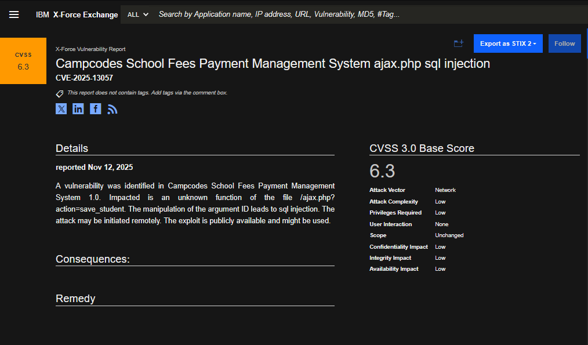
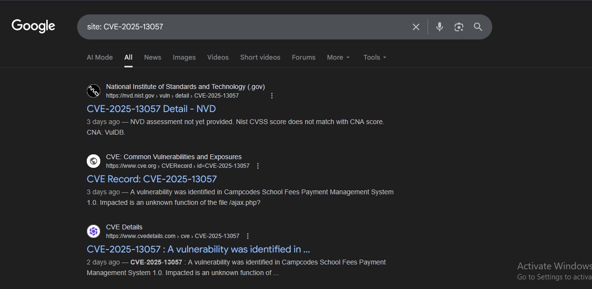
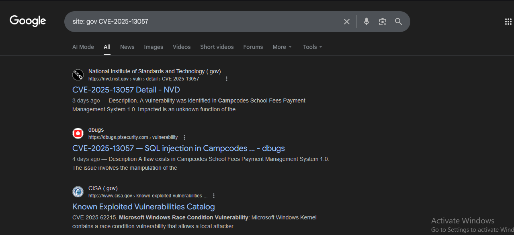
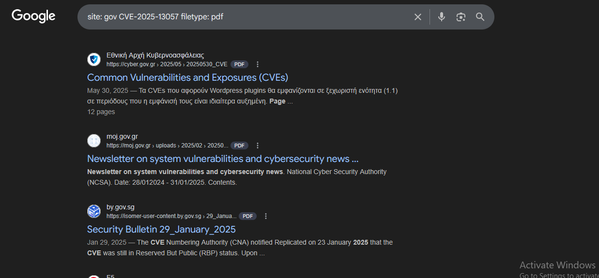
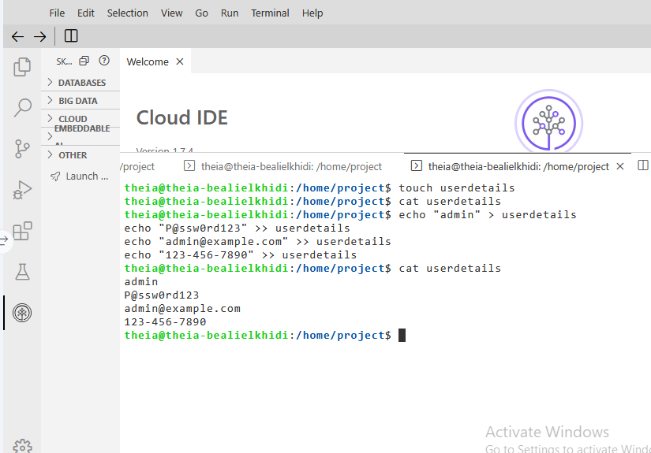
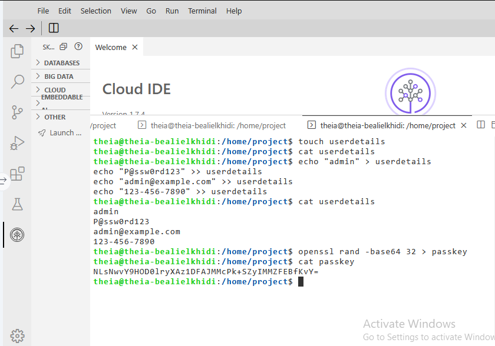
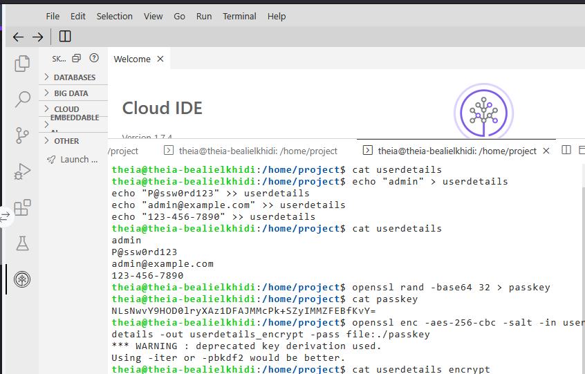
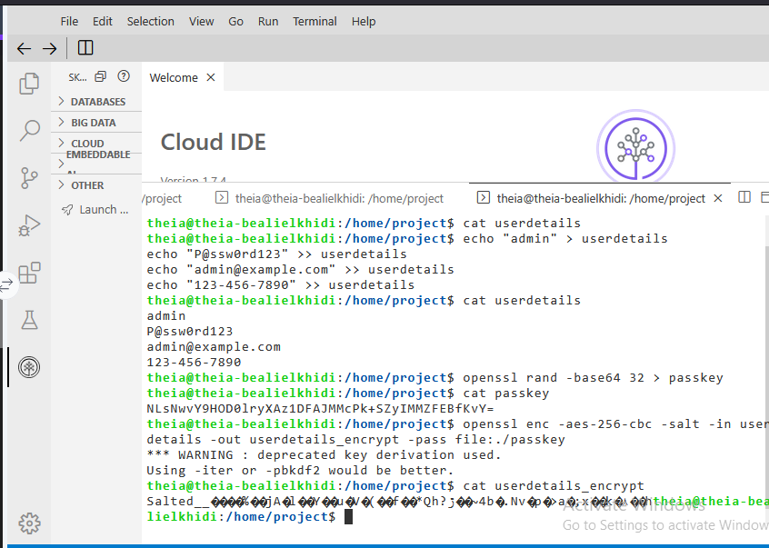
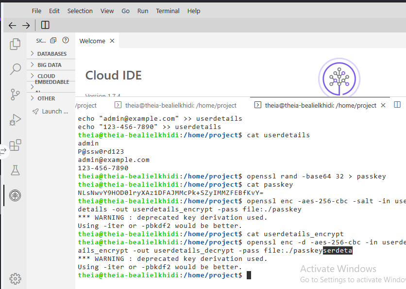
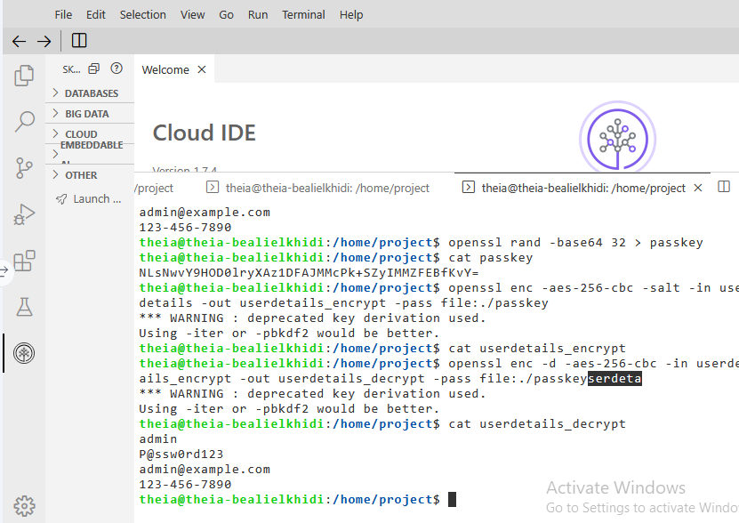

# Penetration Test Planning & Symmetric Encryption Lab

Final project from the IBM *Penetration Testing, Threat Hunting, and Cryptography* course (Coursera). I played an ethical hacker hired by a fictional mid-sized financial institution, "SecureBank", to research vulnerabilities, plan a penetration test, and protect sensitive data with encryption.

## Skills demonstrated
- Threat intelligence and CVE research (IBM X-Force Exchange)
- OSINT with Google dorking operators (`site:`, `filetype:`)
- Penetration test planning: scope, objectives, rules of engagement, discovery, exploitation, reporting
- Symmetric encryption and decryption with OpenSSL (AES-256-CBC)
- Linux command line: `touch`, `echo`, `cat`, `openssl`

## Tools
IBM X-Force Exchange · Google Search · OpenSSL · Linux terminal (Skills Network Cloud IDE)

---

## Part 1: Vulnerability analysis and penetration test planning

### Task 1: Identify a vulnerability with IBM X-Force Exchange
I searched X-Force Exchange for a recent vulnerability with a CVE ID and selected **CVE-2025-13057**, an SQL injection flaw in the Campcodes School Fees Payment Management System 1.0 (CVSS 6.3, network attack vector, low complexity, exploit publicly available).


*X-Force Exchange report for CVE-2025-13057 showing the description and CVSS 3.0 breakdown.*

### Task 2: Investigate the CVE with Google dorking
**Step 1: `site: CVE-2025-13057`**
Pulled up public sources describing the vulnerability, including NIST NVD, the CVE.org record and CVE Details.


*Search results for the CVE, led by the NVD entry.*

**Step 2: `site: gov CVE-2025-13057`**
Narrowed results toward government sources. The NIST NVD entry is the relevant .gov result; other results were loosely related (for example a CISA catalog page for a different CVE).


*Results restricted toward .gov domains.*

**Step 3: `site: gov CVE-2025-13057 filetype: pdf`**
Searched for PDF reports on government sites. The results were general government CVE bulletins rather than reports about this specific CVE, which is a useful finding in itself: newly published CVEs often have no dedicated government PDFs yet.


*PDF results from .gov domains.*

> Note: the canonical Google syntax has no space after the colon (`site:gov`, `filetype:pdf`).

### Task 3: Penetration testing plan
Scenario-based decisions for the SecureBank engagement:

| Phase | Decision | Justification |
|---|---|---|
| 1. Scope | Include all systems, networks and applications | The environment spans external web apps, internal databases and on-premises and cloud services, so the scope must cover the whole infrastructure. |
| 2. Objectives | Focus on compliance with industry standards | Regulatory compliance is mandatory for a financial institution, and testing against recognized standards also exercises controls that reduce phishing risk, such as access control and monitoring. |
| 3. Rules of engagement | Test after business hours, with staff notified | This minimizes the risk of disrupting normal operations while still allowing the assessment to proceed safely. |
| 4. Discovery | Combine automated and manual techniques | Automated tools like Nmap and Nessus give breadth, while manual techniques fill gaps when network information is limited. |
| 5. Exploitation | Highest-severity vulnerabilities first | Prioritizing by severity addresses the greatest risks to the organization first and reduces potential impact. |
| 6. Reporting | Detailed technical report plus executive summary | Technical teams get actionable detail, and leadership gets clear, high-level insight for decision-making. |

---

## Part 2: Secure information with symmetric encryption (AES-256)

Using sample credentials only (no real data), I encrypted and decrypted a file with OpenSSL.

### Step 1: Create the `userdetails` file
Created the file with `touch` and `echo`, then displayed it with `cat`.


*The plaintext `userdetails` file containing the sample credentials.*

### Step 2: Generate a random AES key
```bash
openssl rand -base64 32 > passkey
```

*A random 256-bit key generated and stored in `passkey`. This is a throwaway lab key.*

### Step 3: Encrypt the file
```bash
openssl enc -aes-256-cbc -salt -in userdetails -out userdetails_encrypt -pass file:./passkey
```

*Encryption succeeded; OpenSSL warned that the default key derivation is deprecated.*

### Step 4: Inspect the encrypted file

*`cat` on the encrypted file shows unreadable binary data beginning with the `Salted__` header.*

### Step 5: Decrypt the file
```bash
openssl enc -d -aes-256-cbc -in userdetails_encrypt -out userdetails_decrypt -pass file:./passkey
```

*The same key decrypts the file into `userdetails_decrypt`.*

### Step 6: Verify the result

*The decrypted output matches the original credentials exactly.*

---

## What I learned
- How to use public threat intelligence and search operators to research a vulnerability
- How a penetration test is planned end to end, from scope and rules of engagement to reporting
- How symmetric encryption works in practice: one shared key encrypts and decrypts, so protecting the key is as important as the encryption
- The OpenSSL deprecation warning means a stronger form should be used in real work:
  `openssl enc -aes-256-cbc -pbkdf2 -iter 100000 -salt ...`
- Real keys and credentials must never be committed to a repository. Everything shown here is sample data from a disposable lab environment.

*Lab provided by IBM via Coursera. This README describes my own work and results.*
